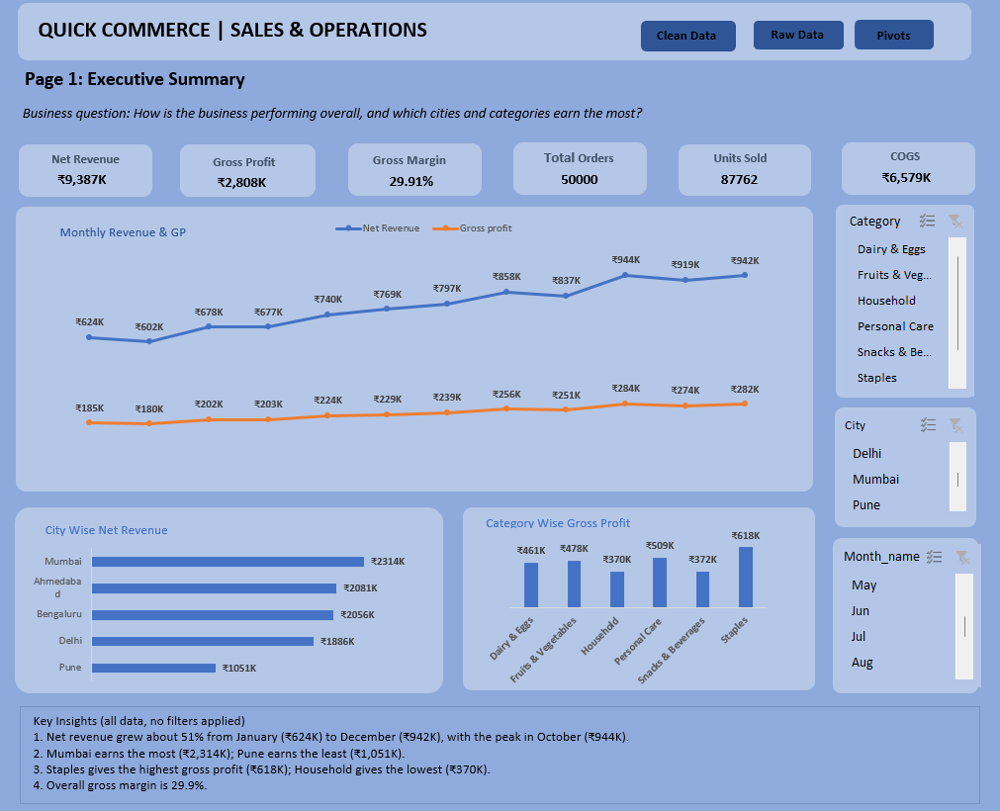

# ecommerce-sales-dashboard
Interactive Excel dashboard for e-commerce sales, orders, delivery time, and cancellation analysis.

)## About
A 2-page Excel dashboard built on 50,000 synthetic quick-commerce orders. It tracks sales, profit, delivery time and cancellations, and helps answer two business questions:
1. How is the business performing overall, and which cities and categories earn the most?
2. Which hours have the slowest delivery, and how does slow delivery affect cancellations?

- **Page 1 (Executive Summary):** revenue, gross profit, margin, orders, units sold, COGS, and city-wise and category-wise performance.
- **Page 2 (Operations and Delivery):** orders by hour, delivery time, cancellations and cancel reasons.

Built with Excel: Power Query, Pivot Tables, Pivot Charts and Slicers.

Note: This is a synthetic (sample) dataset created for practice.
